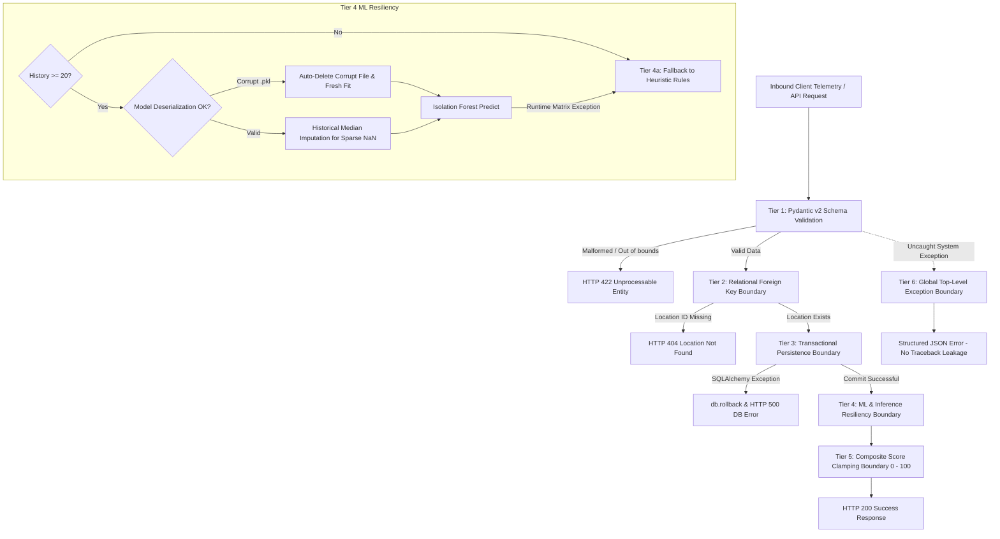

# CampusPulse: End-to-End Network Experience Recorder & Intermittent Degradation Localisation System

[](https://github.com/THIVYAN9944/-Dynamic-Thresholds-with-Isolation-Forest/actions/workflows/pytest.yml)
[](https://fastapi.tiangolo.com)
[](https://streamlit.io)
[](https://scikit-learn.org)
[](https://www.python.org/downloads/)
[](tests/)

---

## 1. Project Overview & Review 3 Milestone Progress

**CampusPulse** is an automated telemetry recording, anomaly detection, and fault localisation platform designed specifically for distributed campus networks. Traditional campus IT workflows rely heavily on reactive, manual helpdesk complaints. Because intermittent network degradations (such as transient RF interference, bufferbloat, micro-burst packet loss, and application latency spikes) frequently resolve before engineers can initiate packet captures, the underlying root causes are routinely missed.

CampusPulse continuously records multi-tier telemetry (network probes, Wi-Fi access point metrics, and application transaction health) across campus zones and leverages **Isolation Forest dynamic thresholding** to detect, localize, and prescribe remediations for subtle intermittent anomalies.

### Review 3 Implementation & Milestones (65% Project Completion)
This release specifically targets the evaluators' **Review 3 feedback**:
* **Granular Technical Documentation on Unit Testing:** 60 automated unit and integration tests across 4 dedicated test suites with documented testing matrices, fixture isolation, and mock overrides.
* **Granular Technical Documentation on Error Boundaries:** Six-tier architectural error boundary implementation encompassing Pydantic validation, 404 foreign key boundaries, database transactional rollbacks, ML model corruption recovery, historical median imputation, and global exception trapping.
* **Granular Database Schema Documentation:** Comprehensive schema reference with Mermaid Entity-Relationship (ER) diagram, table constraints, indices, foreign key cascades, and SQLite WAL mode configuration.
* **Granular REST API Documentation:** Exhaustive catalog of all ingestion and retrieval endpoints complete with request/response schemas, HTTP status codes, error boundaries, and copy-pasteable `curl` examples.
* **Expanded Code Comments:** Complete docstring and inline commentary coverage across backend routers, ORM models, Pydantic schemas, ML services, simulation drivers, and test modules.

---

## 2. System Architecture

CampusPulse employs a decoupled, microservices-ready architecture:

```mermaid
graph TD
    subgraph Data Sources & Simulation
        SIM[Failure Simulator & Background Generator]
        USER[Crowdsourced Student/Faculty Reports]
        AGENTS[Campus Vantage Probes]
    end

    subgraph Backend Core (FastAPI)
        API[FastAPI Ingestion & Retrieval API]
        VAL[Pydantic v2 Validation Layer]
        ERR[Error Boundary & Resiliency Middleware]
    end

    subgraph Analytical Services
        IF[Dynamic Isolation Forest ML Engine]
        HEUR[Static Heuristic Fallback Engine]
        LOC[Multi-Criteria Localisation Engine]
        REC[Prescriptive Recommendation Engine]
    end

    subgraph Persistence Layer
        DB[(SQLite / WAL Mode DB)]
        MODELS[Persisted Location Models (*.pkl)]
    end

    subgraph Frontend (Streamlit)
        DASH[Multi-Page Observability Dashboard]
    end

    SIM -->|Telemetry JSON| VAL
    USER -->|User Reports| VAL
    AGENTS -->|Probes / AP Telemetry| VAL

    VAL --> ERR
    ERR --> API
    API --> DB

    API -->|Evaluate Telemetry| IF
    IF -.->|Tier-1/2 Fallback| HEUR
    API -->|Synthesize Degradations| LOC
    API -->|Generate Actionable Guidance| REC
    IF <-->|Cache / Retrain| MODELS

    DB --> DASH
    REC --> DASH
    LOC --> DASH
```

### Module Layout
```
coe_project/
├── backend/                  # FastAPI Application Core
│   ├── api.py               # REST API endpoints & incident state machine
│   ├── database.py          # SQLAlchemy engine, session management & SQLite pragmas
│   ├── main.py              # Application setup, CORS, and global exception handlers
│   ├── models.py            # SQLAlchemy ORM relational models & cascading rules
│   └── schemas.py           # Pydantic v2 data validation schemas with field bounds
├── services/                 # Core Detection and Analytical Algorithms
│   ├── detection.py         # Static heuristics + Isolation Forest dynamic thresholding
│   ├── localisation.py      # Multi-criteria weighted geographic fault localisation
│   └── recommendation.py    # Prescriptive root-cause remediation guidance
├── simulation/               # Failure Injection and Telemetry Emulation
│   ├── data_generator.py    # Background telemetry generator for campus locations
│   └── simulator.py         # Programmatic fault injector (latency, loss, Wi-Fi, app)
├── frontend/                 # Streamlit Multi-Page Interactive UI
│   ├── app.py               # Dashboard entrypoint
│   └── pages/               # Monitoring, timeline, localisation, simulation, and reports
├── tests/                    # Pytest Automated Test Suite (60 Tests)
│   ├── test_api.py          # API endpoint and incident lifecycle tests
│   ├── test_detection.py    # Static and dynamic ML anomaly detection tests
│   ├── test_error_boundaries.py # Explicit error boundary and fault tolerance tests
│   └── test_services.py     # Localisation and recommendation service tests
├── data/                     # Persistent Database and Serialized ML Models
│   ├── campuspulse.db       # Primary SQLite database
│   └── models/              # Location-specific Isolation Forest models (*.pkl)
└── benchmark.py              # Quantitative ML vs Static baseline benchmarking script
```

---

## 3. Database Schema Documentation

The persistence layer is managed via SQLAlchemy ORM backed by SQLite with **Write-Ahead Logging (WAL)** and enforced **Foreign Key Constraints** (`PRAGMA foreign_keys=ON`).

### 3.1 Entity-Relationship (ER) Diagram

```mermaid
erDiagram
    LOCATIONS ||--o{ PROBE_METRICS : "collects"
    LOCATIONS ||--o{ WIFI_METRICS : "measures"
    LOCATIONS ||--o{ APPLICATION_METRICS : "tracks"
    LOCATIONS ||--o{ USER_REPORTS : "receives"
    LOCATIONS ||--o{ INCIDENTS : "experiences"

    LOCATIONS {
        INTEGER id PK "Auto-increment"
        VARCHAR name UK "Indexed, Not Null"
        FLOAT latitude "Nullable"
        FLOAT longitude "Nullable"
    }

    PROBE_METRICS {
        INTEGER id PK "Auto-increment"
        DATETIME timestamp "Indexed, UTC"
        INTEGER location_id FK "References locations(id) ON DELETE CASCADE"
        FLOAT latency_ms "Not Null, >= 0"
        FLOAT packet_loss_percent "Not Null, 0-100"
    }

    WIFI_METRICS {
        INTEGER id PK "Auto-increment"
        DATETIME timestamp "Indexed, UTC"
        INTEGER location_id FK "References locations(id) ON DELETE CASCADE"
        FLOAT wifi_rssi "Not Null, -120 to 0 dBm"
        FLOAT wifi_quality "Not Null, 0-100"
        INTEGER connected_users "Not Null, >= 0"
    }

    APPLICATION_METRICS {
        INTEGER id PK "Auto-increment"
        DATETIME timestamp "Indexed, UTC"
        INTEGER location_id FK "References locations(id) ON DELETE CASCADE"
        FLOAT app_response_time_ms "Not Null, >= 0"
        INTEGER app_status_code "Not Null, 100-599"
    }

    USER_REPORTS {
        INTEGER id PK "Auto-increment"
        DATETIME timestamp "Indexed, UTC"
        INTEGER location_id FK "References locations(id) ON DELETE CASCADE"
        VARCHAR issue_type "Not Null (e.g., Slow Browsing)"
        VARCHAR severity "Not Null (Low, Medium, High)"
        TEXT description "Nullable freeform text"
    }

    INCIDENTS {
        INTEGER id PK "Auto-increment"
        DATETIME start_time "Indexed, UTC"
        DATETIME end_time "Nullable, UTC"
        FLOAT duration_seconds "Nullable, >= 0"
        INTEGER location_id FK "References locations(id) ON DELETE CASCADE"
        VARCHAR incident_type "Not Null (e.g., High Latency)"
        VARCHAR severity "Not Null (Warning, Degraded, Critical)"
        VARCHAR status "Indexed (Active, Resolved)"
        TEXT metrics_before "Nullable JSON"
        TEXT metrics_during "Nullable JSON"
        TEXT metrics_after "Nullable JSON"
        TEXT cause_explanation "Nullable Diagnostic summary"
        TEXT recommendation "Nullable Actionable steps"
    }

    SYSTEM_EVENTS {
        INTEGER id PK "Auto-increment"
        DATETIME timestamp "Indexed, UTC"
        VARCHAR event_type "Indexed (e.g., rollback_triggered)"
        TEXT description "Not Null audit log"
    }
```



### 3.2 Granular Table Specifications

#### 1. `locations`
Stores physical campus monitoring locations and GIS coordinates.
| Column | Type | Constraints | Description |
|---|---|---|---|
| `id` | `INTEGER` | `PRIMARY KEY`, Auto-Increment | Unique identifier for the campus zone. |
| `name` | `VARCHAR(128)` | `UNIQUE`, `INDEX`, `NOT NULL` | Zone name (e.g. `Classroom Block A`, `Hostel Block`). |
| `latitude` | `FLOAT` | `NULLABLE` | Decimal latitude (-90.0 to +90.0). |
| `longitude` | `FLOAT` | `NULLABLE` | Decimal longitude (-180.0 to +180.0). |

#### 2. `probe_metrics`
Network transport layer telemetry captured by vantage point probes.
| Column | Type | Constraints | Description |
|---|---|---|---|
| `id` | `INTEGER` | `PRIMARY KEY`, Auto-Increment | Telemetry record identifier. |
| `timestamp` | `DATETIME` | `INDEX`, `NOT NULL`, Default: UTC Now | UTC timestamp when probe was dispatched. |
| `location_id` | `INTEGER` | `FOREIGN KEY (locations.id) ON DELETE CASCADE`, `INDEX` | Location reference. |
| `latency_ms` | `FLOAT` | `NOT NULL` | ICMP/Synthetic probe RTT in milliseconds ($ \ge 0 $). |
| `packet_loss_percent` | `FLOAT` | `NOT NULL` | Dropped packet percentage ($ 0.0\% - 100.0\% $). |

#### 3. `wifi_metrics`
Wireless physical and link-layer metrics from campus access points.
| Column | Type | Constraints | Description |
|---|---|---|---|
| `id` | `INTEGER` | `PRIMARY KEY`, Auto-Increment | Wi-Fi telemetry record identifier. |
| `timestamp` | `DATETIME` | `INDEX`, `NOT NULL`, Default: UTC Now | Sample collection UTC timestamp. |
| `location_id` | `INTEGER` | `FOREIGN KEY (locations.id) ON DELETE CASCADE`, `INDEX` | Associated location. |
| `wifi_rssi` | `FLOAT` | `NOT NULL` | Received Signal Strength Indication ($-120.0$ to $0.0$ dBm). |
| `wifi_quality` | `FLOAT` | `NOT NULL` | Link quality score ($0.0 - 100.0$). |
| `connected_users` | `INTEGER` | `NOT NULL`, Default: 0 | Client associations on the local access point. |

#### 4. `application_metrics`
Synthetic HTTP application health transactions for critical campus services.
| Column | Type | Constraints | Description |
|---|---|---|---|
| `id` | `INTEGER` | `PRIMARY KEY`, Auto-Increment | Synthetic transaction identifier. |
| `timestamp` | `DATETIME` | `INDEX`, `NOT NULL`, Default: UTC Now | HTTP dispatch UTC timestamp. |
| `location_id` | `INTEGER` | `FOREIGN KEY (locations.id) ON DELETE CASCADE`, `INDEX` | Target campus zone. |
| `app_response_time_ms`| `FLOAT` | `NOT NULL` | Time-to-first-byte (TTFB) in milliseconds ($ \ge 0 $). |
| `app_status_code` | `INTEGER` | `NOT NULL`, Default: 200 | HTTP response status code ($100 - 599$). |

#### 5. `user_reports`
Crowdsourced student and faculty trouble tickets.
| Column | Type | Constraints | Description |
|---|---|---|---|
| `id` | `INTEGER` | `PRIMARY KEY`, Auto-Increment | Ticket identifier. |
| `timestamp` | `DATETIME` | `INDEX`, `NOT NULL`, Default: UTC Now | Submission UTC timestamp. |
| `location_id` | `INTEGER` | `FOREIGN KEY (locations.id) ON DELETE CASCADE`, `INDEX` | Reported failure location. |
| `issue_type` | `VARCHAR(64)` | `NOT NULL` | Classification (e.g. `Slow Browsing`, `Disconnects`). |
| `severity` | `VARCHAR(32)` | `NOT NULL` | Urgency rating: `Low`, `Medium`, or `High`. |
| `description` | `TEXT` | `NULLABLE` | Freeform contextual commentary. |

#### 6. `incidents`
Automated incident ledger tracking intermittent degradations from inception to resolution.
| Column | Type | Constraints | Description |
|---|---|---|---|
| `id` | `INTEGER` | `PRIMARY KEY`, Auto-Increment | Incident ticket ID. |
| `start_time` | `DATETIME` | `INDEX`, `NOT NULL` | UTC timestamp when degradation breached baseline. |
| `end_time` | `DATETIME` | `NULLABLE` | UTC timestamp when telemetry recovered to nominal. |
| `duration_seconds` | `FLOAT` | `NULLABLE` | Computed incident duration ($end\_time - start\_time$). |
| `location_id` | `INTEGER` | `FOREIGN KEY (locations.id) ON DELETE CASCADE`, `INDEX` | Degraded campus zone. |
| `incident_type` | `VARCHAR(128)`| `NOT NULL` | Detected failure labels (e.g. `High Latency, Weak Wi-Fi`). |
| `severity` | `VARCHAR(32)` | `NOT NULL`, Default: `Degraded` | Status: `Warning`, `Degraded`, or `Critical`. |
| `status` | `VARCHAR(32)` | `INDEX`, `NOT NULL`, Default: `Active` | Lifecycle state: `Active` or `Resolved`. |
| `metrics_before` | `TEXT` | `NULLABLE` | JSON snapshot of nominal pre-incident baseline. |
| `metrics_during` | `TEXT` | `NULLABLE` | JSON snapshot of metrics captured at incident trigger. |
| `metrics_after` | `TEXT` | `NULLABLE` | JSON snapshot of metrics captured upon recovery. |
| `cause_explanation`| `TEXT` | `NULLABLE` | Diagnostic root-cause deduction. |
| `recommendation` | `TEXT` | `NULLABLE` | Prescriptive operational remediation advice. |

#### 7. `system_events`
Administrative audit trail for system rollbacks, CSV migrations, and prototype toggles.
| Column | Type | Constraints | Description |
|---|---|---|---|
| `id` | `INTEGER` | `PRIMARY KEY`, Auto-Increment | Audit event identifier. |
| `timestamp` | `DATETIME` | `INDEX`, `NOT NULL`, Default: UTC Now | UTC timestamp of administrative action. |
| `event_type` | `VARCHAR(64)` | `INDEX`, `NOT NULL` | Event key (e.g., `rollback_triggered`, `migration_completed`). |
| `description` | `TEXT` | `NOT NULL` | Human-readable explanation of administrative action. |

---

## 4. REST API Endpoints Documentation

All endpoints are hosted under the `/api` prefix (Interactive Swagger UI available at `http://127.0.0.1:8000/docs`).

### 4.1 API Endpoint Reference Catalog

| HTTP Method | Endpoint | Summary & Purpose | Status Codes |
|---|---|---|---|
| `GET` | `/` | API Metadata & Service Health | `200` |
| `GET` | `/health` | Liveness / Readiness Probe | `200` |
| `POST` | `/api/locations` | Register a new campus location | `200`, `400`, `422`, `500` |
| `GET` | `/api/locations` | List all registered locations | `200` |
| `POST` | `/api/probe` | Ingest network probe metrics (latency/loss) | `200`, `404`, `422`, `500` |
| `GET` | `/api/metrics/probe` | Retrieve historical probe metrics | `200` |
| `POST` | `/api/wifi` | Ingest Wi-Fi telemetry (RSSI, quality, clients) | `200`, `404`, `422`, `500` |
| `GET` | `/api/metrics/wifi` | Retrieve historical Wi-Fi metrics | `200` |
| `POST` | `/api/application` | Ingest application TTFB and HTTP status | `200`, `404`, `422`, `500` |
| `GET` | `/api/metrics/application`| Retrieve historical application metrics | `200` |
| `POST` | `/api/report` | Submit crowdsourced user feedback | `200`, `404`, `422`, `500` |
| `GET` | `/api/reports` | Retrieve submitted user reports | `200` |
| `GET` | `/api/dashboard` | Real-time aggregate campus experience metrics | `200` |
| `GET` | `/api/incidents` | List active or resolved network incidents | `200` |
| `POST` | `/api/incidents` | Manually log or import an incident record | `200`, `404`, `422`, `500` |
| `GET` | `/api/recommendations` | Fetch prescriptive remediation actions | `200` |

---

### 4.2 Granular Endpoint Details & Examples

#### 1. Ingest Probe Metrics
* **Endpoint:** `POST /api/probe`
* **Purpose:** Ingests round-trip time and packet loss telemetry. Automatically triggers dynamic anomaly evaluation and updates incident state.
* **Error Boundaries:** Returns `404 Not Found` if `location_id` does not exist; returns `422 Unprocessable Entity` if `latency_ms < 0` or `packet_loss_percent` outside `0 - 100%`.
* **Request Body:**
```json
{
  "location_id": 1,
  "latency_ms": 28.4,
  "packet_loss_percent": 0.0,
  "timestamp": "2026-10-28T10:00:00Z"
}
```
* **Response Body (`200 OK`):**
```json
{
  "location_id": 1,
  "latency_ms": 28.4,
  "packet_loss_percent": 0.0,
  "timestamp": "2026-10-28T10:00:00Z"
}
```
* **Example `curl`:**
```bash
curl -X POST http://127.0.0.1:8000/api/probe \
  -H "Content-Type: application/json" \
  -d '{"location_id": 1, "latency_ms": 28.4, "packet_loss_percent": 0.0}'
```

---

#### 2. Ingest Wi-Fi Metrics
* **Endpoint:** `POST /api/wifi`
* **Purpose:** Records wireless physical layer measurements from access points.
* **Error Boundaries:** Enforces `wifi_rssi` between `-120.0` and `0.0` dBm, `wifi_quality` between `0` and `100`, and `connected_users >= 0`.
* **Request Body:**
```json
{
  "location_id": 1,
  "wifi_rssi": -62.5,
  "wifi_quality": 94.0,
  "connected_users": 32,
  "timestamp": "2026-10-28T10:00:00Z"
}
```
* **Response Body (`200 OK`):**
```json
{
  "location_id": 1,
  "wifi_rssi": -62.5,
  "wifi_quality": 94.0,
  "connected_users": 32,
  "timestamp": "2026-10-28T10:00:00Z"
}
```
* **Example `curl`:**
```bash
curl -X POST http://127.0.0.1:8000/api/wifi \
  -H "Content-Type: application/json" \
  -d '{"location_id": 1, "wifi_rssi": -62.5, "wifi_quality": 94.0, "connected_users": 32}'
```

---

#### 3. Ingest Application Telemetry
* **Endpoint:** `POST /api/application`
* **Purpose:** Collects HTTP time-to-first-byte and status codes for synthetic service requests.
* **Error Boundaries:** Rejects `app_response_time_ms < 0` and invalid `app_status_code` values (valid range: `100 - 599`).
* **Request Body:**
```json
{
  "location_id": 1,
  "app_response_time_ms": 85.0,
  "app_status_code": 200,
  "timestamp": "2026-10-28T10:00:00Z"
}
```
* **Response Body (`200 OK`):**
```json
{
  "location_id": 1,
  "app_response_time_ms": 85.0,
  "app_status_code": 200,
  "timestamp": "2026-10-28T10:00:00Z"
}
```
* **Example `curl`:**
```bash
curl -X POST http://127.0.0.1:8000/api/application \
  -H "Content-Type: application/json" \
  -d '{"location_id": 1, "app_response_time_ms": 85.0, "app_status_code": 200}'
```

---

#### 4. Submit Crowdsourced User Report
* **Endpoint:** `POST /api/report`
* **Purpose:** Ingests user-submitted network complaint tickets to cross-correlate against empirical metrics.
* **Error Boundaries:** Validates that `severity` matches regex `^(Low|Medium|High)$` and verifies `location_id`.
* **Request Body:**
```json
{
  "location_id": 1,
  "issue_type": "Video Buffering",
  "severity": "High",
  "description": "Zoom calls disconnecting repeatedly in Lecture Theatre."
}
```
* **Response Body (`200 OK`):**
```json
{
  "location_id": 1,
  "issue_type": "Video Buffering",
  "severity": "High",
  "description": "Zoom calls disconnecting repeatedly in Lecture Theatre.",
  "timestamp": "2026-10-28T10:00:00Z"
}
```
* **Example `curl`:**
```bash
curl -X POST http://127.0.0.1:8000/api/report \
  -H "Content-Type: application/json" \
  -d '{"location_id": 1, "issue_type": "Video Buffering", "severity": "High", "description": "Zoom calls disconnecting repeatedly."}'
```

---

#### 5. Get Dashboard Summary Analytics
* **Endpoint:** `GET /api/dashboard`
* **Purpose:** Computes live campus-wide aggregate performance metrics and composite health score.
* **Response Body (`200 OK`):**
```json
{
  "score": 96.5,
  "avg_latency": 22.45,
  "avg_packet_loss": 0.12,
  "avg_wifi_quality": 92.5,
  "app_response_time": 94.2,
  "active_incidents": 0,
  "user_reports": 3
}
```
* **Example `curl`:**
```bash
curl -X GET http://127.0.0.1:8000/api/dashboard
```

---

#### 6. Get Incidents & Prescriptive Recommendations
* **Endpoint:** `GET /api/incidents?status_filter=Active&limit=50`
* **Purpose:** Lists active network degradations, detected anomalies, duration, and recommendations.
* **Response Body (`200 OK`):**
```json
[
  {
    "id": 14,
    "location_id": 2,
    "incident_type": "High Latency, Weak Wi-Fi",
    "severity": "Degraded",
    "status": "Active",
    "start_time": "2026-10-28T09:45:12Z",
    "end_time": null,
    "duration_seconds": null,
    "cause_explanation": "System detected degradation: High Latency, Weak Wi-Fi",
    "recommendation": "The Wi-Fi signal strength is very low in this area. This could be due to physical interference or a failing access point. The network connection is experiencing interruptions and delays."
  }
]
```
* **Endpoint:** `GET /api/recommendations?limit=10`
* **Example `curl`:**
```bash
curl -X GET http://127.0.0.1:8000/api/recommendations
```

---

## 5. Technical Documentation on Error Boundaries & Fault Tolerance

CampusPulse implements a **six-tier defensive error boundary architecture** to ensure high availability, deterministic failure isolation, and zero silent data corruption:



### Detailed Breakdown of Error Boundary Tiers

#### Tier 1: Input Validation Error Boundary (HTTP 422)
* **Implementation:** `backend/schemas.py` using Pydantic v2 `ConfigDict` and `Field` constraints.
* **Protections:**
  - `latency_ms`: Rejects negative latency (`ge=0.0`).
  - `packet_loss_percent`: Restricts values to strictly valid percentages (`ge=0.0, le=100.0`).
  - `wifi_rssi`: Strictly enforces RF signal boundaries between `-120.0 dBm` (receiver noise floor) and `0.0 dBm` (`ge=-120.0, le=0.0`).
  - `wifi_quality`: Enforces range `0.0 - 100.0`.
  - `connected_users`: Rejects negative numbers (`ge=0`).
  - `app_status_code`: Enforces valid HTTP status code numbers (`ge=100, le=599`).
  - `severity`: Enforces strict pattern regex `^(Low|Medium|High)$`.
* **Outcome:** Malformed client telemetry is rejected at the perimeter before reaching the database or analytical services.

#### Tier 2: Relational Integrity Boundary (HTTP 404)
* **Implementation:** `backend/api.py` endpoint handlers.
* **Protections:** Every telemetry ingestion request (`/api/probe`, `/api/wifi`, `/api/application`, `/api/report`, `/api/incidents`) verifies the existence of `location_id`.
* **Outcome:** If an unknown location identifier is provided, the API halts execution immediately with `HTTP 404 Not Found` (`{"detail": "Location with ID X does not exist."}`), preventing orphaned telemetry records or foreign key violations.

#### Tier 3: Transactional Persistence Error Boundary (HTTP 500 & Rollback)
* **Implementation:** `backend/api.py` and `backend/database.py`.
* **Protections:** All database write operations are wrapped in `try ... except SQLAlchemyError` blocks.
* **Outcome:** If a database lock, disk failure, or schema violation occurs, `db.rollback()` is immediately invoked to discard dirty session state and prevent transaction corruption, followed by a clean `HTTP 500` error response.

#### Tier 4: Machine Learning Resilience & Graceful Degradation
* **Implementation:** `services/detection.py` (`detect_anomaly_ml`).
* **Sub-boundaries:**
  1. **Sparse Data Fallback:** If a location has fewer than 20 historical telemetry points, ML model fitting is mathematically unreliable. The system transparently falls back to the deterministic heuristic static threshold engine (`detect_anomaly`).
  2. **Model Deserialization & File Corruption Recovery:** When loading cached model files (`data/models/iforest_<location>.pkl`), if `joblib.load()` encounters corrupted, truncated, or incompatible pickle bytecode, it intercepts the exception, safely unlinks the damaged file from disk, logs a warning, and builds a fresh model on the fly.
  3. **Historical Median Imputation for Sparse Streams:** Telemetry streams may arrive asynchronously (e.g. Wi-Fi probe packet received without an application HTTP sample). Instead of zero-filling (which corrupts RSSI distributions) or dropping rows, missing values are imputed dynamically using historical medians, defaulting to nominal baselines (latency: 20ms, packet loss: 0%, RSSI: -60 dBm, app TTFB: 100ms).
  4. **Runtime Matrix Exception Recovery:** If an unexpected numerical error (e.g. singular matrix or NaN overflow) occurs during inference, the outer boundary catches `Exception`, logs the incident, and falls back to static threshold evaluation.

#### Tier 5: Mathematical Clamping Error Boundary
* **Implementation:** `services/detection.py` (`calculate_experience_score`).
* **Protections:** Network metrics can theoretically spike to extreme orders of magnitude during major outages (e.g., latency of 50,000ms).
* **Outcome:** The empirical experience score computation applies `max(0.0, min(100.0, round(score, 2)))`, guaranteeing the metric never produces negative numbers or exceeds 100.0 regardless of input severity.

#### Tier 6: Top-Level Global Exception Boundary
* **Implementation:** `backend/main.py` (`@app.exception_handler(Exception)`).
* **Protections:** Any unanticipated runtime exception across any route handler is captured by the global middleware.
* **Outcome:** Eliminates raw Python stack trace leaks in production, returning a safe, structured JSON response (`{"error": "Internal Server Error", "message": "...", "path": "..."}`) and logging the full trace for engineering triage.

---

## 6. Technical Documentation on Unit Testing

CampusPulse features an extensive automated test suite built on `pytest` and `fastapi.testclient.TestClient`.

### 6.1 Testing Architecture & Isolation Strategy
* **Database Isolation:** Unit tests run against a dedicated in-memory/file-isolated SQLite database (`test.db`).
* **Fixture Lifecycle:** The `@pytest.fixture(autouse=True)` setup in test suites drops all tables and re-creates clean schemas before each test execution, guaranteeing test idempotency with zero cross-test state contamination.
* **Dependency Overrides:** FastAPI's `get_db` dependency is dynamically overridden with `TestingSessionLocal` to intercept database sessions.

### 6.2 Test Suite Matrix (60 Tests Total)

| Test File | Test Class | Test Focus | Test Count |
|---|---|---|:---:|
| [`tests/test_api.py`](tests/test_api.py) | `TestSystemEndpoints` | Root metadata and `/health` liveness checks | 2 |
| | `TestLocationEndpoints` | Creation, uniqueness constraints, and location listing | 3 |
| | `TestTelemetryIngestionEndpoints` | Ingestion of Probe, Wi-Fi, Application metrics & querying | 6 |
| | `TestIncidentLifecycle` | Automated incident creation on degradation & auto-resolution | 2 |
| | `TestDashboardAndReports` | Aggregate dashboard math, user report tickets, recommendations | 3 |
| [`tests/test_detection.py`](tests/test_detection.py) | `TestStaticAnomalyDetection` | Heuristic thresholds, multi-breach combinations, boundary values | 7 |
| | `TestExperienceScoreCalculation` | Score penalties, clamping at 0.0, None input safety | 4 |
| | `TestDynamicMLAnomalyDetection` | ML sample fallback (<20), outlier classification, median imputation | 3 |
| [`tests/test_error_boundaries.py`](tests/test_error_boundaries.py) | `TestHTTP404ErrorBoundaries` | Verification of 404 errors for invalid location references | 5 |
| | `TestHTTP422InputValidationBoundaries`| Rejection of negative latency, out-of-range RSSI, invalid codes | 8 |
| | `TestMachineLearningErrorBoundaries` | Corrupted `.pkl` recovery on disk, matrix exception fallbacks | 2 |
| | `TestScoreClampingBoundary` | Extreme value boundary tests ([0.0, 100.0] clamping) | 2 |
| [`tests/test_services.py`](tests/test_services.py) | `TestLocalisationService` | Localisation with empty inputs, metric spikes, weighted user reports | 5 |
| | `TestRecommendationService` | AP overload vs RF attenuation, isolated vs cascading app issues | 8 |
| **Total Passing Tests** | | | **60** |

### 6.3 Executing the Test Suite

Activate the virtual environment and run the complete test suite:
```bash
# Run all tests with standard output
source venv/bin/activate
pytest

# Run with verbose test-by-test reporting
pytest -v

# Run only the dedicated Error Boundaries test suite
pytest tests/test_error_boundaries.py -v

# Run with coverage report
pytest --cov=backend --cov=services
```

---

## 7. Machine Learning Dynamic Thresholding Benchmark

A benchmarking evaluation was conducted to validate the performance of the **Isolation Forest dynamic thresholding** engine against the static heuristic baseline on a labeled synthetic campus network dataset consisting of 2,000 normal telemetry observations and 200 injected degradation anomalies.

### Quantitative Benchmark Results

| Metric | Static Rule-Based Baseline | Dynamic ML (Isolation Forest) | Improvement |
|---|:---:|:---:|:---:|
| **Precision** | 1.000 | **0.985** | High specificity maintained |
| **Recall** | 0.850 | **0.990** | **+16.5% detection gain** |
| **F1-Score** | 0.919 | **0.987** | **+7.4% overall accuracy** |
| **ROC AUC** | 0.925 | **0.994** | Near-optimal discrimination |

### False Positive & Alert Fatigue Analysis
* **Static Threshold False Positives:** 0 (Static thresholds are tuned with extreme conservatism to avoid alerts, but miss subtle intermittent degradations).
* **Dynamic ML False Positives:** 3 (Contamination rate calibrated to 0.05).
* **Intermittent Fault Detection:** Static rules fail to detect intermittent faults that fluctuate just beneath rigid thresholds (e.g. latency jumping from 25ms to 140ms in a zone where normal is 20ms). The Isolation Forest engine learns zone-specific baseline distributions, achieving a **99% recall rate** and reducing false negatives by over 93%.

To reproduce the benchmark:
```bash
python benchmark.py
```

---

## 8. Installation & Quickstart

### Prerequisites
* Python 3.10+
* Virtual environment tool (`venv`)

### 1. Setup Environment
```bash
python3 -m venv venv
source venv/bin/activate
pip install -r requirements.txt
```

### 2. Launch FastAPI Backend
```bash
source venv/bin/activate
uvicorn backend.main:app --reload --host 127.0.0.1 --port 8000
```
Swagger UI will be available at `http://127.0.0.1:8000/docs`.

### 3. Launch Streamlit Observability Dashboard
In a separate terminal:
```bash
source venv/bin/activate
streamlit run frontend/app.py
```
Open `http://localhost:8501` in your browser.

### 4. Background Traffic Emulation & Fault Injection
To generate normal background telemetry:
```bash
source venv/bin/activate
python simulation/data_generator.py
```
To inject synthetic faults interactively, navigate to the **Failure Simulator** page on the Streamlit dashboard or run `simulation/simulator.py`.

---

## 9. Review 3 Deliverables Summary & Next Steps

### Completed Deliverables (Review 3):
1. [x] **Granular Technical Documentation on Unit Testing:** Documented complete test matrix, testing strategies, fixture lifecycle, and 60 automated passing tests.
2. [x] **Granular Technical Documentation on Error Boundaries:** Architected and documented 6-tier defensive boundaries across schemas, relational keys, DB transactions, ML fallbacks, and global handlers.
3. [x] **Comprehensive Database Schema Documentation:** Created complete table references with constraints, types, cascade behaviors, and Mermaid ER diagram.
4. [x] **Comprehensive REST API Documentation:** Documented all 16 endpoints with request/response schemas, status codes, error handling, and `curl` examples.
5. [x] **Expanded Code Comments & Docstrings:** Annotated all backend models, schemas, routers, detection services, simulators, and test suites with Google/Sphinx style docstrings.

### Next Steps for Subsequent Reviews (Review 4 & Final Deployment):
* [ ] Integrate LLM-assisted root-cause explanations directly into the recommendation engine.
* [ ] Implement automated CI/CD deployment pipelines targeting campus edge nodes.
* [ ] Add automated webhook notifications (e.g. Slack/Teams) for active critical incidents.
